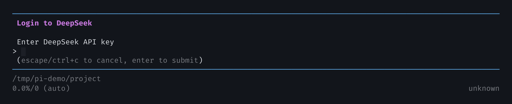
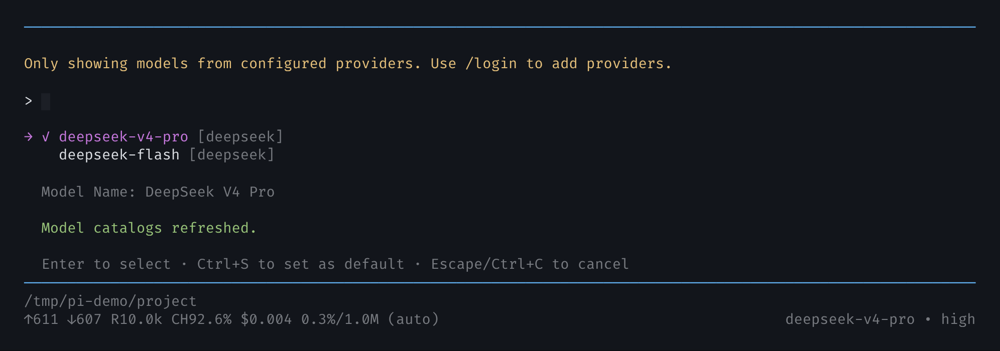
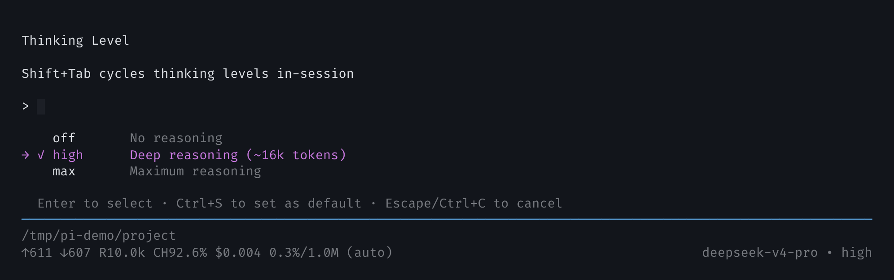
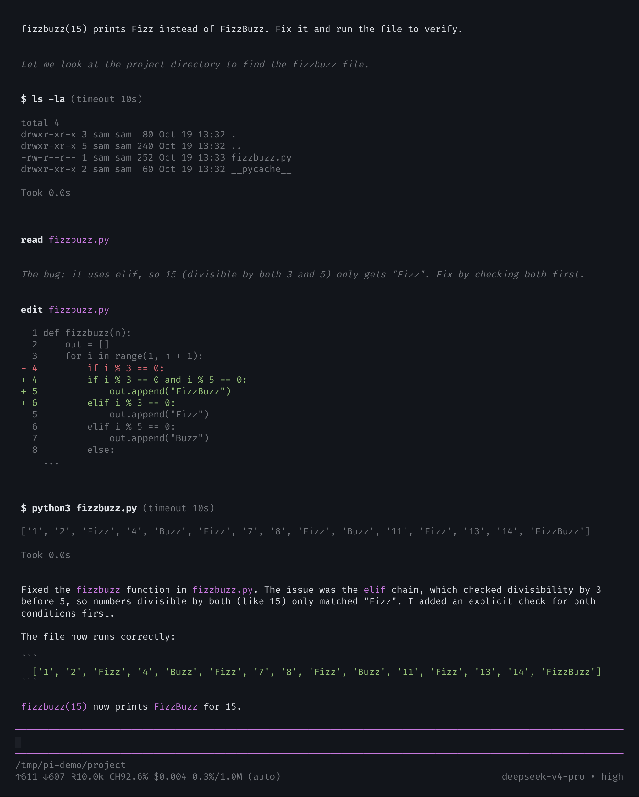

[English](./pi_mono.md) | [简体中文](./pi_mono.zh-CN.md) · [← Back](../README.md)

# Integrate with Pi

[Pi](https://github.com/earendil-works/pi) is a minimal, extensible terminal coding agent with tree-structured sessions, skills, and extensions. Current releases ship a **built-in DeepSeek provider**, so connecting DeepSeek only takes an API key — no `models.json`, custom provider block, or compatibility proxy.

#### 1. Install Pi

- Install [Node.js](https://nodejs.org/en/download/) 22.19 or newer.
- Install Pi from npm:

```bash
npm install -g --ignore-scripts @earendil-works/pi-coding-agent
```

On Windows, use the npm command above. macOS / Linux users can also use the official installer, which pins dependencies and updates with `pi update`:

```bash
curl -fsSL https://pi.dev/install.sh | sh
```

- Verify the installation:

```bash
pi --version
```

#### 2. Connect your DeepSeek API key

Create an API key on the [DeepSeek Platform](https://platform.deepseek.com/api_keys).

**Option A — sign in from Pi (recommended):**

Start Pi, run `/login deepseek`, then paste the key:

```text
$ pi
/login deepseek
```

Pi stores the credential in `~/.pi/agent/auth.json`.



**Option B — environment variable:**

Linux / macOS:

```bash
export DEEPSEEK_API_KEY="<your DeepSeek API key>"
```

Windows PowerShell:

```powershell
$env:DEEPSEEK_API_KEY="<your DeepSeek API key>"
```

Check that Pi can see the credential:

```bash
pi auth check --provider deepseek --json
# {"status":"ready","provider":"deepseek","authType":"api_key"}
```

#### 3. Select a DeepSeek model

Start Pi in your project and open the model picker with `/model`, then type `deepseek` to filter:

```bash
cd /path/to/my-project
pi
```



| Model ID        | Model                 | Best for                | Context | Max output |
| --------------- | --------------------- | ----------------------- | ------- | ---------- |
| `deepseek-v4-pro` | DeepSeek V4 Pro     | Hard coding and reasoning | 1M    | 384K       |
| `deepseek-flash`  | DeepSeek V4.1 Flash | Fast, inexpensive, vision | 1M    | 384K       |

When DeepSeek is the only configured provider, Pi selects `deepseek-v4-pro` by default. Press `Ctrl+S` in the picker to make it the startup default.

Pi's model catalog already declares the 1M context window and the 384K output limit, so there is no `context_window` or `max_tokens` field to set.

You can also pin the model and thinking level for a single run:

```bash
pi --model deepseek/deepseek-v4-pro:max
```

> Use the current model IDs. The API still accepts the legacy names `deepseek-v4-flash` and `deepseek-v4-flash-vision-exp`, but those models are retired: requests are served by DeepSeek-V4.1-Flash, which is `deepseek-flash` in Pi.

#### 4. Set the thinking level

DeepSeek V4 models use thinking mode by default. Run `/thinking` to inspect or change it:



- `off` — no reasoning
- `high` — Pi's default for this model
- `max` — maximum reasoning for hard problems

`Shift+Tab` cycles thinking levels in-session, and `Ctrl+S` saves the starting level. If you logged in during the current session, run `/thinking` once and pick `high` or `max`.

#### 5. First run

Ask Pi to work on the project. It reads and edits files, runs commands, and records the session as a tree you can rewind.



The status line shows the active model, thinking level, context usage, and an estimated cost.

#### Configuration reference

| Item            | Value                                                        |
| --------------- | ------------------------------------------------------------ |
| Provider ID     | `deepseek` (built in)                                        |
| Base URL        | `https://api.deepseek.com`                                   |
| API format      | OpenAI-compatible (`openai-completions`)                     |
| Credential      | `/login deepseek`, `DEEPSEEK_API_KEY`, or `--api-key`        |
| Context window  | 1,000,000 tokens                                             |
| Max output      | 384,000 tokens                                               |
| Thinking levels | `off`, `high`, `max`                                         |

No `models.json` entry is required. If you need a gateway or a self-hosted endpoint, add a separate provider in `~/.pi/agent/models.json` rather than overriding the built-in `deepseek` provider.

#### Pricing

Per 1M tokens in USD, from the [DeepSeek pricing page](https://api-docs.deepseek.com/quick_start/pricing). Peak hours are 01:00–04:00 and 06:00–10:00 UTC, Monday–Friday, excluding Chinese public holidays; all other hours are off-peak.

| Model                        | Cache hit | Cache miss | Output |
| ---------------------------- | --------- | ---------- | ------ |
| `deepseek-v4-pro` (off-peak) | $0.022    | $0.66      | $1.98  |
| `deepseek-v4-pro` (peak)     | $0.044    | $1.32      | $3.96  |
| `deepseek-flash` (off-peak)  | $0.003    | $0.15      | $0.60  |
| `deepseek-flash` (peak)      | $0.006    | $0.30      | $1.20  |

Pi's in-session cost estimate uses the catalog's peak rates, so off-peak usage is billed at roughly half of the displayed number.

#### Troubleshooting

| Symptom                                                       | Fix                                                                                                  |
| ------------------------------------------------------------- | ---------------------------------------------------------------------------------------------------- |
| `/model` is empty, or shows "Only showing models from configured providers" | No credential is configured. Run `/login deepseek` or export `DEEPSEEK_API_KEY`, then reopen `/model`. |
| `401` or another authentication error                         | Check the key on the DeepSeek Platform and run `/login deepseek` again.                               |
| Model not found                                               | Use `deepseek-v4-pro` or `deepseek-flash`; `deepseek-chat` and `deepseek-reasoner` no longer exist.    |
| An older Pi build without DeepSeek                            | Update with `pi update`, or reinstall from npm.                                                       |

#### Learn more

- [Pi documentation](https://github.com/earendil-works/pi/tree/main/packages/coding-agent/docs)
- [Pi model configuration](https://github.com/earendil-works/pi/blob/main/packages/coding-agent/docs/models.md)
- [DeepSeek API docs](https://api-docs.deepseek.com/)
